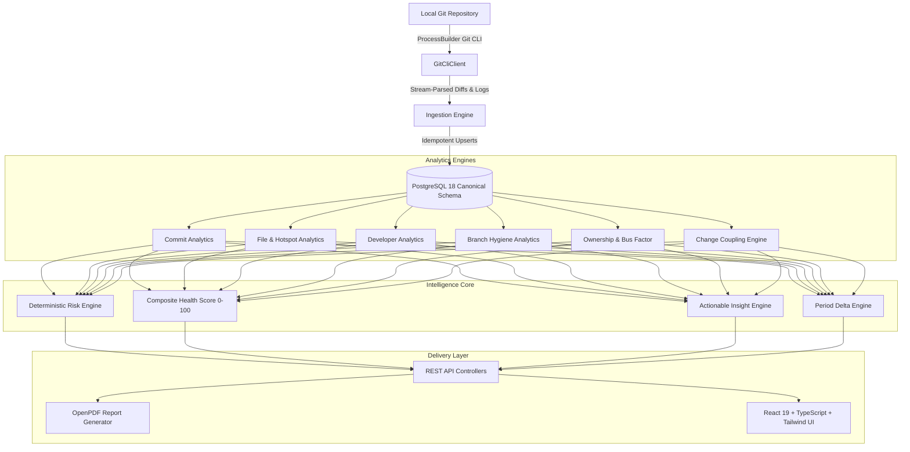

# 🔍 RepoVision — Autonomous Engineering Intelligence & Repository Health Platform

<div align="center">

[](https://github.com/vasanthan-hub)
[](https://github.com/vasanthan-hub/RepoVision)
[](https://spring.io/projects/spring-boot)
[](https://react.dev/)
[](https://www.oracle.com/java/)
[](https://www.postgresql.org/)
[](LICENSE)

<br/>

> **"Git tells you what happened. RepoVision tells you what it means."**

*An end-to-end engineering analytics platform built from the ground up by **[Vasanthan R](https://github.com/vasanthan-hub)** that converts raw Git commit histories, branch references, and file diffs into structured domain facts, deterministic software engineering metrics, architectural risk signals, multidimensional repository health scores, and actionable engineering recommendations.*

</div>

---

## 🌟 Key Highlights & Engineering Achievements

- **Zero-Fabrication Analytical Pipeline**: All metrics, risk scores, bus factor calculations, and health indices are derived deterministically from canonical Git facts stored in PostgreSQL — never hardcoded or simulated.
- **Explainable Hotspots & Risk Engine**: 7-factor deterministic risk identification (High Churn, Knowledge Silos, Abandoned Branches, Megacommits, Co-change Coupling) with concrete evidence and mitigation playbooks.
- **Defensible Bus Factor Algorithm**: Computes the exact minimum number of engineers whose departure would orphan >50% of the active codebase.
- **Hidden Co-Change Coupling**: Uncovers invisible architectural dependencies using co-commit intersection ratios.
- **Period-over-Period Delta Engine ("What Changed?")**: Deterministic natural-language and KPI trend analysis across 7/14/30/60/90-day comparison horizons.
- **Enterprise PDF & CSV Reports**: High-density executive PDF health summaries generated server-side via OpenPDF alongside granular CSV exports.
- **Production-Grade Dark UI**: Custom engineering cockpit built with React 19, TypeScript, Tailwind CSS v4, and Recharts.

---

## 🏛️ System Architecture

RepoVision is architected as a **Feature-Based Modular Monolith** in Java 17 / Spring Boot with a high-performance React 19 client:



### Analytical Progression Model
$$\text{Raw Git Data} \longrightarrow \text{Repository Facts} \longrightarrow \text{Deterministic Metrics} \longrightarrow \text{Architectural Signals} \longrightarrow \text{Risk \& Health Scoring} \longrightarrow \text{Actionable Insights}$$

---

## 🔬 Core Capabilities & Mathematical Formulations

### 1. Repository Management & Idempotent Ingestion
- Local Git repository discovery, path validation, and branch enumeration.
- **Guaranteed Idempotence**: Ingesting a repository 1 time or 100 times results in the exact same database state with zero duplicate commits or file change rows.

### 2. Commit Analytics & Velocity
- Commit frequency distributions, net growth, and code churn ($Churn = Additions + Deletions$).
- Median change sizes and megacommit detection ($>1,000$ lines changed).

### 3. File Analytics & Architectural Hotspot Scoring
Identifies files suffering from high churn, frequent edits, and distributed complexity:
$$\text{Hotspot Score} = \left(0.40 \cdot \text{norm}(\text{modCount}) + 0.35 \cdot \text{norm}(\text{churn}) + 0.15 \cdot \text{recencyFactor} + 0.10 \cdot \text{norm}(\text{contributors})\right) \times 100$$

### 4. Ownership Analytics & Bus Factor Resilience
- Aggregates canonical developer identities across git aliases.
- File-level primary maintainer calculation and module concentration (`HIGH`, `MODERATE`, `BALANCED`).
- **Defensible Bus Factor**: Calculates the smallest subset of engineers who author $\ge 50\%$ of the codebase files.

### 5. Hidden Architectural Coupling (Co-Change Analysis)
Detects implicit dependencies between distant modules that always change together:
$$\text{Coupling \%} = \frac{\text{Commits}(A \cap B)}{\min(\text{Commits}(A), \text{Commits}(B))} \times 100$$
Categorized into `STRONG` ($\ge 70\%$), `MODERATE` ($\ge 40\%$), and `WEAK`.

### 6. 7-Point Deterministic Risk Engine
| Risk Signal | Detection Criteria | Architectural Impact |
|---|---|---|
| **HOTSPOT** | Top-tier modification count + high code churn | Fragile components prone to regression bugs |
| **HIGH_CHURN** | Anomalous turnover exceeding 2σ historical baseline | Rapidly refactored or unstable modules |
| **OWNERSHIP_CONCENTRATION** | Single author owns $>80\%$ of critical files | High bus factor vulnerability and knowledge silos |
| **STALE_BRANCH** | No commits for $\ge 30$ days | Divergence overhead and high merge conflict risk |
| **LARGE_COMMIT** | Individual commit modifies $>1,000$ lines | Compromised code review quality |
| **DECLINING_ACTIVITY** | $>50\%$ drop in commit velocity period-over-period | Stalled initiatives or project stagnation |
| **STRONG_CHANGE_COUPLING** | Co-change score $\ge 70\%$ across distinct directories | Hidden architectural tight coupling |

### 7. Multidimensional Composite Health Score (0–100)
- **Activity (20%)**: Commit cadence and contributor activity.
- **Stability (25%)**: Low churn volatility and absence of severe hotspots.
- **Branch Hygiene (20%)**: Merge velocity and stale branch ratio.
- **Ownership Distribution (20%)**: Bus factor resilience and balanced author shares.
- **Release Velocity (15%)**: Tag regularity and deployment rhythm.

---

## 🛠️ Technology Stack

| Layer | Technology | Version / Spec |
|---|---|---|
| **Backend Core** | Java JDK | 17 LTS |
| **Application Framework** | Spring Boot | 4.1.1 (WebMVC, Data JPA, Actuator) |
| **Database** | PostgreSQL | 18 |
| **Git Engine** | Java ProcessBuilder Git CLI | Custom streaming parser |
| **Report Generation** | OpenPDF | 2.0.3 |
| **Test Framework** | JUnit 5 + Mockito | 15/15 unit & integration suites passing |
| **Frontend Framework** | React + TypeScript | React 19, TypeScript 5.8 |
| **Build Tool** | Vite | 8.3 |
| **Styling** | Tailwind CSS | v4 (Custom dark engineering palette) |
| **Data Visualizations** | Recharts | 3.10 |
| **Icons** | Lucide React | Latest |

---

## 📡 REST API Reference

| Endpoint | Method | Description |
|---|---|---|
| `/api/repositories` | `GET`, `POST` | List or register local Git repositories |
| `/api/repositories/{id}` | `GET`, `DELETE` | Retrieve or delete repository metadata |
| `/api/repositories/{id}/commits` | `GET` | Run ingestion and fetch canonical commits |
| `/api/repositories/{id}/overview` | `GET` | Composite repository overview metrics |
| `/api/repositories/{id}/analytics/commits` | `GET` | Commit timelines, churn, and histograms |
| `/api/repositories/{id}/analytics/developers` | `GET` | Developer contribution & churn share |
| `/api/repositories/{id}/analytics/files` | `GET` | File modification frequency and churn |
| `/api/repositories/{id}/analytics/files/hotspots` | `GET` | Calculated architectural hotspots |
| `/api/repositories/{id}/analytics/files/detail` | `GET` | Deep file history & contributor breakdown |
| `/api/repositories/{id}/analytics/branches` | `GET` | Branch hygiene & stale branch detection |
| `/api/repositories/{id}/analytics/ownership` | `GET` | File ownership & bus factor analysis |
| `/api/repositories/{id}/analytics/coupling` | `GET` | Co-change coupling relationships |
| `/api/repositories/{id}/intelligence/risks` | `GET` | Deterministic architectural risks |
| `/api/repositories/{id}/intelligence/health` | `GET` | Multidimensional 0–100 health breakdown |
| `/api/repositories/{id}/intelligence/insights` | `GET` | Actionable engineering recommendations |
| `/api/repositories/{id}/analytics/comparison` | `GET` | Period-over-period delta metrics |
| `/api/repositories/{id}/intelligence/what-changed` | `GET` | Natural-language changelog analysis |
| `/api/repositories/{id}/analytics/releases` | `GET` | Release tag cadence and churn |
| `/api/repositories/{id}/reports/pdf` | `GET` | Executive PDF health report |
| `/api/repositories/{id}/reports/csv/{type}` | `GET` | Granular CSV datasets (`commits`, `files`, `developers`, `risks`) |

---

## 🚀 Getting Started Locally

### Prerequisites
- **Java 17 JDK** (Oracle OpenJDK or Eclipse Temurin)
- **Node.js 20+** and **npm**
- **PostgreSQL 18** (or 15+)
- **Git CLI** accessible in system `PATH`

### 1. Database Provisioning
```sql
CREATE DATABASE repovision;
CREATE USER repovision_app WITH ENCRYPTED PASSWORD 'ChangeThisPassword123!';
GRANT ALL PRIVILEGES ON DATABASE repovision TO repovision_app;
```

### 2. Launch Backend
```powershell
cd c:\RepoVision\backend
.\mvnw.cmd clean spring-boot:run
```
*Backend initializes on `http://localhost:8080` and creates JPA schema automatically.*

### 3. Launch Frontend
```powershell
cd c:\RepoVision\frontend
npm install
npm run dev
```
*Frontend will be running on `http://localhost:5173` with instant hot-reload.*

---

## 🧪 Verification & Quality Assurance

### Run Backend Test Suite
```powershell
cd c:\RepoVision\backend
.\mvnw.cmd test
```
*Results: 15/15 tests passing across Git parsers, hotspot calculators, coupling engines, and risk rules.*

### Validate Frontend TypeScript & Build
```powershell
cd c:\RepoVision\frontend
npm run build
```
*Results: 0 TypeScript errors, bundle optimized for production.*

---

## 👨‍💻 Author & Creator

<div align="center">

### **Vasanthan R**
*Lead Architect & Software Engineer*

[](https://github.com/vasanthan-hub)
[](mailto:vasanthanr2004@gmail.com)

Designed and engineered with care by **Vasanthan R**. If you find this project insightful, consider starring the repository ⭐

</div>

---

## 📄 License

This project is licensed under the **MIT License** — see the [LICENSE](LICENSE) file for details.
