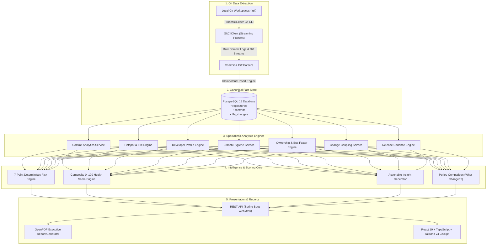

<div align="center">

# ⚡ RepoVision
### Autonomous Engineering Intelligence & Repository Health Cockpit

*Git tells you what happened. RepoVision tells you what it means.*

<br/>

[](https://github.com/vasanthan-hub)
[](https://github.com/vasanthan-hub/RepoVision)
[](LICENSE)
[-success?style=for-the-badge&logo=apache-maven&logoColor=white)](#-verification--quality-assurance)

<br/>

[](https://spring.io/projects/spring-boot)
[](https://www.oracle.com/java/)
[](https://react.dev/)
[](https://www.typescriptlang.org/)
[](https://www.postgresql.org/)
[](https://tailwindcss.com/)
[](https://vitejs.dev/)

<br/>

[Explore Architecture](#-system-architecture) •
[Core Features](#-core-capabilities) •
[Mathematical Formulations](#-mathematical-models--algorithms) •
[API Reference](#-rest-api-reference) •
[Quickstart](#-quickstart-guide) •
[Author](#-author--creator)

</div>

---

## 📌 Executive Summary

Modern software organizations generate millions of Git events, commits, and pull requests every month. However, engineering leaders and developers still struggle to answer fundamental questions:

* *Which files are accumulating silent architectural debt?*
* *What is our true Bus Factor, and where are single-author knowledge silos forming?*
* *Which disconnected modules have hidden co-change dependencies?*
* *Is our codebase health improving or deteriorating over time?*

**RepoVision** bridges the gap between raw Git telemetry and strategic engineering intelligence. Built as an air-gapped, zero-fabrication analytics platform, it ingests local Git repositories and computes deterministic metrics, architectural risk signals, multidimensional health indices, and actionable engineering recommendations.

---

## ✨ Key Differentiators

| Capability | Legacy Tools / Git Analytics | RepoVision |
|---|---|---|
| **Data Integrity** | Simulated metrics, black-box AI estimations | **100% Deterministic**; directly derived from Git facts |
| **Privacy & Security** | Requires cloud code uploads & third-party SaaS | **100% Local & Air-Gapped**; analyzes local git repos |
| **Ingestion Engine** | Sluggish polling or lossy webhooks | **Idempotent streaming parser** with zero-duplicate guarantee |
| **Coupling Analysis** | Line-level grep or manual dependency trees | **Temporal Co-Change Detection** via commit intersection |
| **Bus Factor Resilience** | Subjective peer surveys | **Mathematical minimum subset** algorithm (>50% ownership) |
| **Executive Output** | Basic dashboard screenshots | **Server-side PDF reports (OpenPDF)** & granular CSV data extracts |

---

## 🏛️ System Architecture

RepoVision follows the **Feature-Based Modular Monolith** architectural pattern, separating analytical ingestion from analytical processing and reactive presentation:



### The Analytical Progression Model
$$\text{Raw Git History} \longrightarrow \text{Domain Facts} \longrightarrow \text{Deterministic Metrics} \longrightarrow \text{Architectural Signals} \longrightarrow \text{Health Score} \longrightarrow \text{Actionable Decisions}$$

---

## 🔬 Mathematical Models & Algorithms

### 1. Architectural Hotspot Score
Computes the maintenance penalty of files subject to intense churn and frequent edits:
$$\text{Hotspot Score} = \left(0.40 \cdot \mathcal{N}(\text{ModCount}) + 0.35 \cdot \mathcal{N}(\text{Churn}) + 0.15 \cdot \mathcal{R}(\text{Recency}) + 0.10 \cdot \mathcal{N}(\text{Authors})\right) \times 100$$
*Where $\mathcal{N}(x)$ is the min-max normalized percentile and $\mathcal{R}(t) = \exp(-\lambda \cdot \Delta t)$ represents time-decay recency.*

### 2. Temporal Change Coupling (Co-Change Detection)
Measures hidden architectural coupling between pairs of files modified across common commits:
$$\text{Coupling Ratio}(A, B) = \frac{|\text{Commits}(A) \cap \text{Commits}(B)|}{\min(|\text{Commits}(A)|, |\text{Commits}(B)|)} \times 100$$
*Classifications: `STRONG` ($\ge 70\%$), `MODERATE` ($\ge 40\%$), `WEAK` ($< 40\%$).*

### 3. Defensible Bus Factor Resilience
Calculates the minimum cardinality of the engineer set $S \subseteq \mathcal{D}$ such that:
$$\sum_{d \in S} \text{OwnedFiles}(d) \ge 0.50 \times \text{TotalFiles}$$
*Where an engineer owns a file if they contributed $\ge 50\%$ of its historical churn.*

### 4. Multidimensional Health Score (0–100)
A weighted composite health index across 5 core pillars:
$$\text{Health Index} = 0.20 \cdot \mathcal{S}_{\text{Activity}} + 0.25 \cdot \mathcal{S}_{\text{Stability}} + 0.20 \cdot \mathcal{S}_{\text{Branch}} + 0.20 \cdot \mathcal{S}_{\text{Ownership}} + 0.15 \cdot \mathcal{S}_{\text{Release}}$$

---

## 🚀 Core Capabilities

```
RepoVision Cockpit
├── 📊 1. Overview Dashboard       → Executive KPIs, velocity curves, bus factor cards, recent risks
├── 📈 2. Commit Analytics         → Activity frequency, code churn, net growth, megacommit detection
├── 👥 3. Developer Profiles       → Alias-consolidated contribution shares, author churn distributions
├── 🎯 4. Files & Hotspots         → Hotspot scoring table, file-level commit logs, author breakdown modal
├── 🌿 5. Branch Hygiene           → Stale branch detection (≥30 days), merge tracking, active heads
├── 🛡️ 6. Ownership & Bus Factor   → Module ownership concentration (High/Moderate/Balanced), bus factor
├── 🔗 7. Change Coupling          → Co-change matrix revealing hidden architectural dependencies
├── ⚠️ 8. Risk Engine              → 7 deterministic detectors with concrete evidence & remediation
├── 🩺 9. Multidimensional Health  → 5-dimension radar analysis with transparent sub-score breakdowns
├── 💡 10. Insight Engine          → Actionable engineering recommendations (Architecture/Hygiene/Team)
├── 🔄 11. What Changed?           → 7/14/30/60/90-day comparison horizons with automated changelog
├── 🏷️ 12. Releases & Tags         → Git release tag intervals, release cadence, commits per release
└── 📄 13. Reports Export          → Executive PDF report generation + CSV data extracts
```

---

## 🛠️ Technology Stack

### Backend Architecture
- **Language**: Java 17 LTS
- **Framework**: Spring Boot 4.1.1 (`spring-boot-starter-webmvc`, `spring-boot-starter-data-jpa`, `actuator`)
- **Database**: PostgreSQL 18
- **Git Integration**: Low-overhead Java `ProcessBuilder` Git CLI streaming parser
- **Reporting Engine**: OpenPDF 2.0.3 (Vector-drawn executive health PDFs)
- **Persistence**: Hibernate ORM 7, HikariCP Connection Pooling
- **Testing**: JUnit 5, Mockito, Spring Boot Test

### Frontend Cockpit
- **Framework**: React 19 + TypeScript 5.8
- **Tooling**: Vite 8.3
- **Design System**: Tailwind CSS v4 (Custom dark engineering theme)
- **Data Visualizations**: Recharts (Responsive Area, Bar, Radar, and Composed charts)
- **Icons**: Lucide React

---

## 📡 REST API Reference

| Method | Endpoint | Description |
|---|---|---|
| `GET` | `/api/repositories` | List all registered repositories |
| `POST` | `/api/repositories` | Register a new local Git repository path |
| `GET` | `/api/repositories/{id}` | Get repository details |
| `DELETE` | `/api/repositories/{id}` | Remove repository from registry |
| `GET` | `/api/repositories/{id}/commits` | Trigger idempotent Git ingestion & retrieve commits |
| `GET` | `/api/repositories/{id}/overview` | Retrieve composite overview summary metrics |
| `GET` | `/api/repositories/{id}/analytics/commits` | Commit timelines, churn statistics, and histograms |
| `GET` | `/api/repositories/{id}/analytics/developers` | Developer contribution & churn share analysis |
| `GET` | `/api/repositories/{id}/analytics/files` | File modification frequency and churn data |
| `GET` | `/api/repositories/{id}/analytics/files/hotspots` | Top architectural hotspots with computed scores |
| `GET` | `/api/repositories/{id}/analytics/files/detail?filePath=...` | File commit history & author distribution |
| `GET` | `/api/repositories/{id}/analytics/branches` | Branch hygiene and stale branch detections |
| `GET` | `/api/repositories/{id}/analytics/ownership` | File ownership and bus factor resilience |
| `GET` | `/api/repositories/{id}/analytics/coupling` | Co-change file coupling matrix |
| `GET` | `/api/repositories/{id}/intelligence/risks` | 7-factor deterministic architectural risk register |
| `GET` | `/api/repositories/{id}/intelligence/health` | Multidimensional 0–100 health index breakdown |
| `GET` | `/api/repositories/{id}/intelligence/insights` | Actionable recommendations by domain category |
| `GET` | `/api/repositories/{id}/analytics/comparison?days=30` | Period-over-period delta metrics |
| `GET` | `/api/repositories/{id}/intelligence/what-changed?days=30` | Natural-language changelog & activity highlights |
| `GET` | `/api/repositories/{id}/analytics/releases` | Release tag intervals and cadence |
| `GET` | `/api/repositories/{id}/reports/pdf` | Download executive PDF health report |
| `GET` | `/api/repositories/{id}/reports/csv/{type}` | Download raw CSV (`commits`, `files`, `developers`, `risks`) |

---

## 📁 Repository Structure

```text
RepoVision/
├── backend/                             # Java 17 + Spring Boot 4 Backend
│   ├── src/main/java/com/repovision/
│   │   ├── analysis/                    # Commit, File, Branch, Coupling Services
│   │   ├── commit/                      # Ingestion pipeline & Git log parsers
│   │   ├── common/                      # Exception handlers, web & CORS configs
│   │   ├── git/                         # ProcessBuilder Git CLI client
│   │   ├── intelligence/                # Risk Engine, Health Score, Insight Engine
│   │   ├── report/                      # OpenPDF report builder & CSV exporter
│   │   └── repository/                  # Repository domain & registry management
│   ├── src/test/java/                   # 15 unit & integration test suites
│   └── pom.xml                          # Maven build configuration
│
├── frontend/                            # React 19 + TypeScript + Vite Cockpit
│   ├── src/
│   │   ├── components/                  # Header, Sidebar, File Detail & Register Modals
│   │   ├── views/                       # 12 distinct analytical dashboard views
│   │   ├── services/                    # API client with Axios / Fetch abstractions
│   │   └── types/                       # TypeScript interfaces mirroring API DTOs
│   ├── package.json                     # Frontend dependencies & scripts
│   └── vite.config.ts                   # Vite build configuration
│
├── .github/                             # GitHub configuration & workflows
├── .gitignore                           # Monorepo gitignore rules
├── LICENSE                              # MIT License
└── README.md                            # Documentation & architecture showcase
```

---

## ⚡ Quickstart Guide

### Prerequisites
- **Java 17 JDK** or higher
- **Node.js 20+** and **npm**
- **PostgreSQL 18** (or 15+)
- **Git CLI** available in your system path

### 1. Configure PostgreSQL
```sql
CREATE DATABASE repovision;
CREATE USER repovision_app WITH ENCRYPTED PASSWORD 'ChangeThisPassword123!';
GRANT ALL PRIVILEGES ON DATABASE repovision TO repovision_app;
```

### 2. Start the Backend Service
```powershell
cd c:\RepoVision\backend
.\mvnw.cmd spring-boot:run
```
*Backend runs on `http://localhost:8080` with auto-configured Spring Data JPA.*

### 3. Start the Frontend Cockpit
```powershell
cd c:\RepoVision\frontend
npm install
npm run dev
```
*Open `http://localhost:5173` in your browser.*

---

## 🧪 Verification & Quality Assurance

### Run Backend Unit & Integration Tests
```powershell
cd c:\RepoVision\backend
.\mvnw.cmd test
```
```text
[INFO] Results:
[INFO] Tests run: 15, Failures: 0, Errors: 0, Skipped: 0
[INFO] BUILD SUCCESS
```

### Run Frontend Production Build
```powershell
cd c:\RepoVision\frontend
npm run build
```
```text
✓ 2474 modules transformed.
dist/index.html                   1.59 kB │ gzip:   0.89 kB
dist/assets/index-DfRXZzIM.css   54.97 kB │ gzip:   8.88 kB
dist/assets/index-Cnjk0oh3.js   740.45 kB │ gzip: 205.27 kB
✓ built in 1.07s (0 errors)
```

---

## 👨‍💻 Author & Creator

<div align="center">

### **Vasanthan R**
*Lead Architect & Software Engineer*

[](https://github.com/vasanthan-hub)
[](mailto:vasanthanr2004@gmail.com)

**RepoVision** was conceptualized, designed, and developed by **Vasanthan R**.  
If you find this project useful or interesting, please leave a star ⭐ on GitHub!

</div>

---

## 📄 License

This project is licensed under the **MIT License** — see the [LICENSE](LICENSE) file for details.
